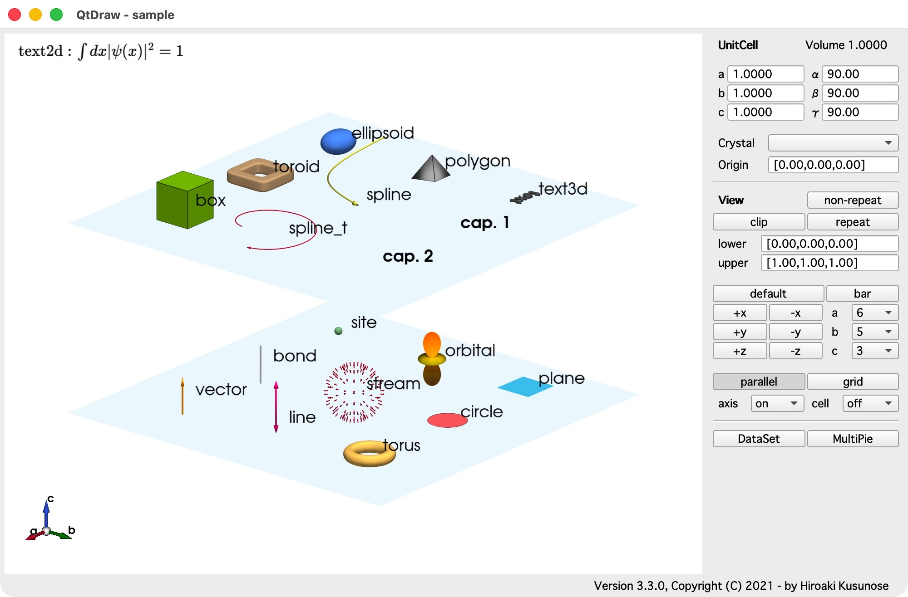
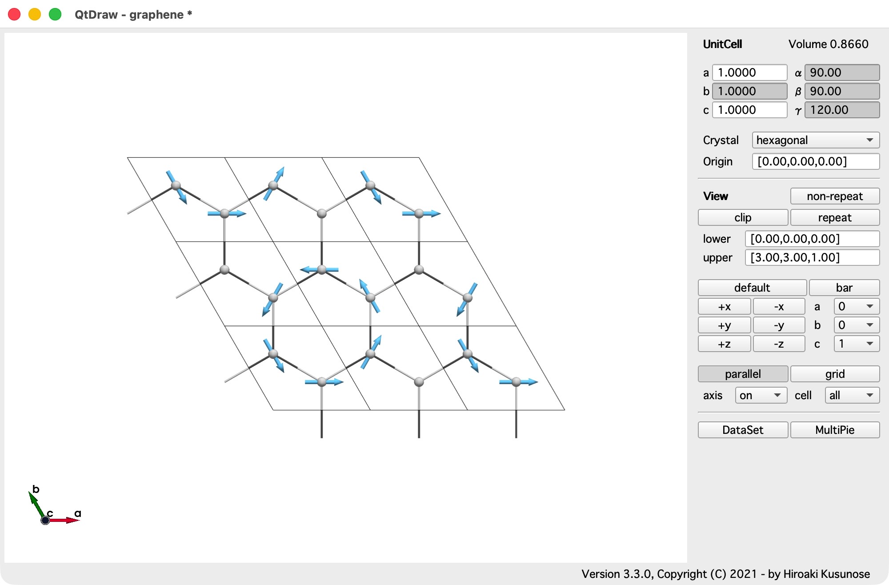
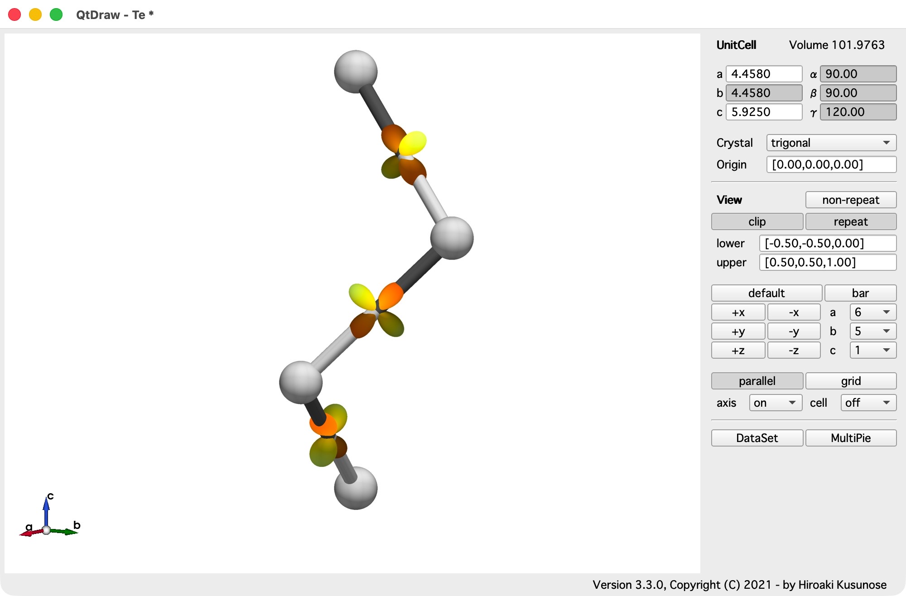
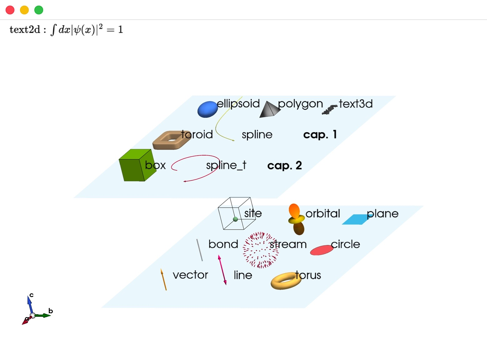
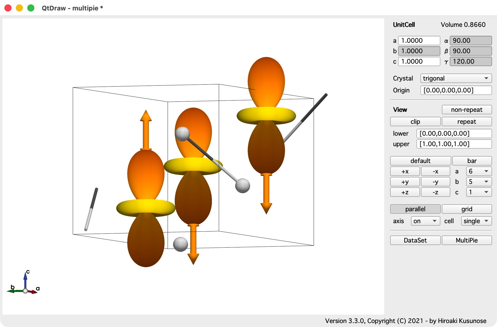
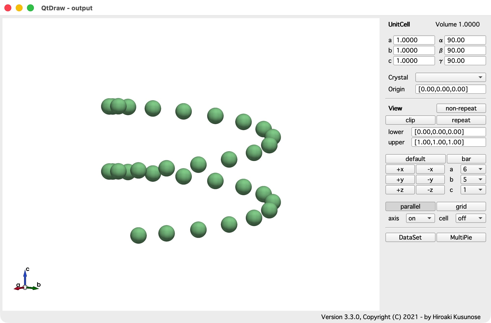
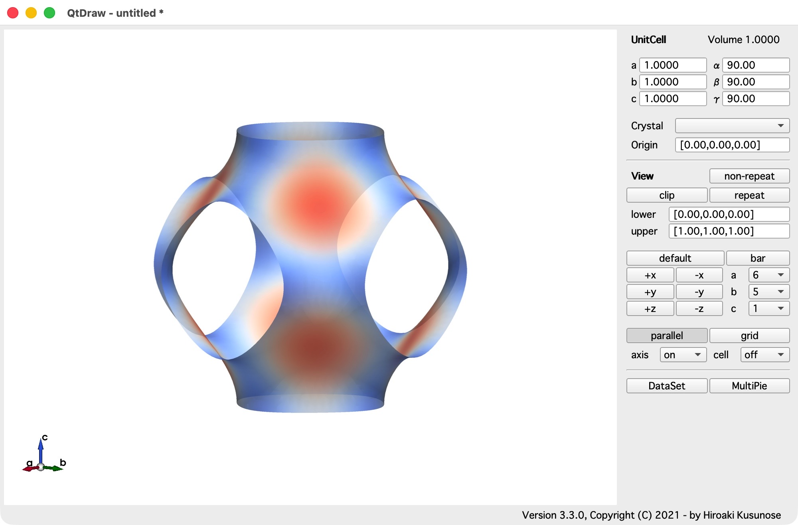

# 例

英語版は[こちら](example.md)です。

**QtDraw** の例です。

## ファイルから読み込む

```{literalinclude} examples/load.py
```

## Jupyter Notebook から

- [QtDraw](examples/qtdraw.ipynb)
  
- [MultiPie を使ったグラフェン](examples/mp_graphene.ipynb)
  
- [MultiPie を使った Te](examples/mp_Te.ipynb)
  
- [PyVistaWidget](examples/pyvista_widget.ipynb)
  
- [MultiPie とともに](examples/multipie.ipynb)
  

## バックグラウンドでの描画

```{literalinclude} examples/background_s.py
```



## 等値面の描画

```{literalinclude} examples/isosurface.py
```


