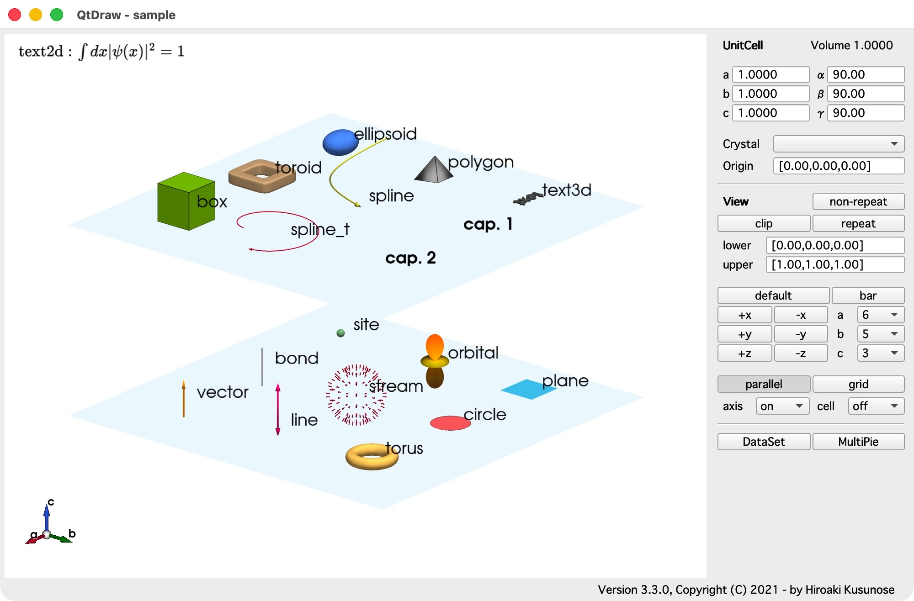
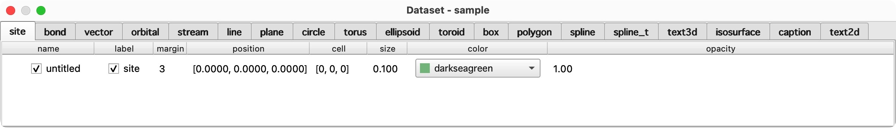
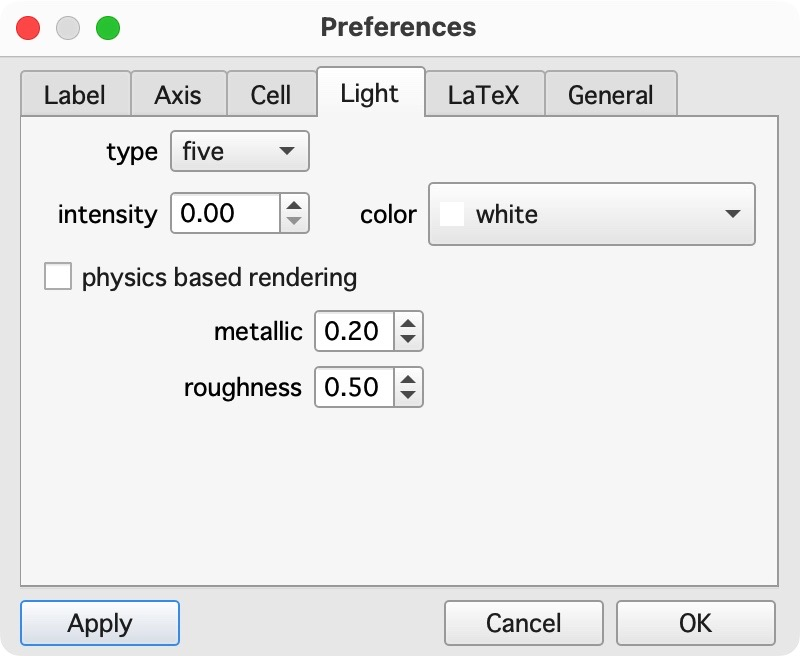

# はじめに

英語版は[こちら](getting_started.md)です。

## メインウィンドウ

**QtDraw** のメインウィンドウは次のとおりで、メインパネルとコントロールパネルがあります。



## オブジェクトの作成と編集

これらのオブジェクトを描くには、`e` キーか右のパネルの `DataSet` ボタンを押します。すると、次のように `DataSet` ウィンドウが表示されます。



`DataSet` ウィンドウでは、タブでオブジェクトの種類を選び、各タブで右クリックのコンテキストメニューからオブジェクトを挿入、コピー、削除できます。最も簡単なのは、まずデフォルト値でオブジェクトを作り、そのあと自由に編集する方法です。

メインパネルでオブジェクトを右クリックするとコンテキストメニューが表示され、そのオブジェクトを削除、非表示にしたり、開いたりできます。

## マウスとキー

メニューバーの `Help` > `Mouse and Keys` にも同じまとめが表示されます。

メインパネルでは：
- 左ドラッグ：回転。Shift + 左ドラッグ：移動。ホイールまたは右ドラッグ：ズーム。
- オブジェクトの上で（ドラッグせずに）右クリック：そのオブジェクトを `DataSet` ウィンドウで開く、非表示にする、削除するためのコンテキストメニュー。
- `e`：`DataSet` ウィンドウを開きます。

`DataSet` ウィンドウでは：
- 右クリック：オブジェクトを挿入、コピー、削除するためのコンテキストメニュー。
- `Esc`：選択を解除します。`Up`、`Down`：選択を移動します。

`File` メニューでは、ファイルを開く (Ctrl+O、macOS では Cmd+O)、最近の 10 個のファイルの一つを開き直す (`Open Recent`)、保存する (Ctrl+S、Cmd+S)、別の名前で保存する (`Save As`、Ctrl+Shift+S、Cmd+Shift+S)、スクリーンショットを保存する、終了する (Ctrl+Q、Cmd+Q) ことができます。`Save` は最後に開いたか保存したファイルに書き出します。初めて保存するときや、CIF、VESTA、XSF のファイルを読み込んだあとは、ファイル名を尋ねます。保存していない変更があるままウィンドウを閉じると、QtDraw は保存するかどうかを尋ねます。変更がなければ、すぐに閉じます。

`Edit` メニューでは、オブジェクト、単位胞、範囲、MultiPie の群の変更を元に戻す (Ctrl+Z、macOS では Cmd+Z)、やり直す（プラットフォームによって Ctrl+Y または Ctrl+Shift+Z、macOS では Cmd+Shift+Z）ことができます。カメラ、表示の設定、環境設定は、元に戻す・やり直すの対象になりません。ファイルを開くと新しい履歴が始まり、保存しても履歴は保たれます。`Clear` は確認なしにすべてのオブジェクトを削除しますが、元に戻すことができます。`DataSet` は（`e` キーと同じく）すべてのオブジェクトの表を開き、`Preferences` は環境設定を開きます（macOS ではアプリケーションメニューにあります）。

`View` メニューでは、パネルと同じように、視点の方向を設定し（+x、+y、+z、-x、-y、-z に Ctrl+1 から Ctrl+6、デフォルトに Ctrl+0。macOS では Cmd）、平行投影、グリッド、スカラーバー、クリップ、繰り返しを切り替え、繰り返しなしに変換し、軸と単位胞の表示を選びます。

`Window` メニューは、QtDraw のメッセージ (`Info`) とログ (`Log`)、そして描画を確認するための内部データ（カメラ、すべてのオブジェクトの生データ、アクターの名前、状態、環境設定。`Camera`、`Data`、`Actor`、`Status`、`Preference`）を表示します。

`Help` メニューは、マウスとキーの操作を表示し、このドキュメントと問題を報告するためのページを開き、バージョンの情報を表示します。

単位胞と表示の設定の下にある `DataSet` ボタンと `MultiPie` ボタンは、`DataSet` ウィンドウと MultiPie のダイアログを開きます。MultiPie がない場合は、`MultiPie` ボタンから pip でインストールできます（出力は `Log` ウィンドウに表示されます）。それが失敗した場合は、手でインストールするためのコマンドを表示します。MultiPie を使った描画は、MultiPie がインストールされているときだけ開けます。環境設定は `Edit` > `Preferences` に、バージョンの情報は `Help` > `About QtDraw` にあります（macOS ではどちらもアプリケーションメニューにあります）。

エラーが起きると、短いメッセージが表示されます。トレースバックは `Show Details...` の中とログにあります。問題を報告するときは、それを含めてください。


## 環境設定

**QtDraw** の見た目と使い勝手は、次のように `Preferences` ダイアログ（`Edit` > `Preferences`。macOS ではアプリケーションメニューにあります）で変更できます。



## Python のコードからのオブジェクトの作成

すべてのオブジェクトは、Python のコードや Jupyter Notebook からも描けます。
Jupyter Notebook の例は [qtdraw.ipynb](examples/qtdraw.ipynb) にあります。
詳しくは [API](from_python_ja.md) を参照してください。
この機能を使うと、バックグラウンドでの処理ができます。
次の例を参照してください。
```{literalinclude} examples/background.py
```
同じことは、次のようにもっと簡単にできます。
```{literalinclude} examples/background_s.py
```

ほかの例については、[例のページ](example_ja.md)を参照してください。
