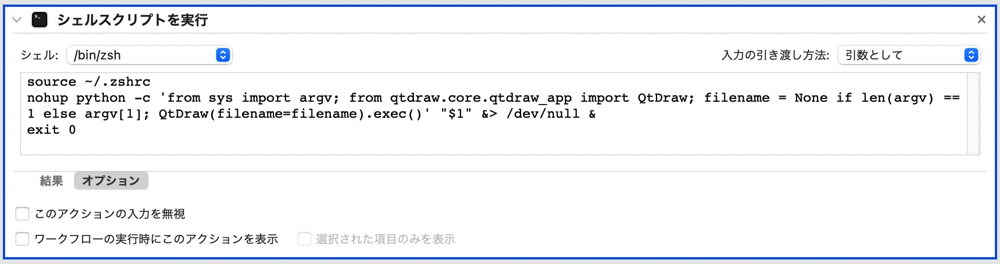

# QtDraw のインストール

英語版は[こちら](install.md)です。

**QtDraw** は、Python 3.12 以降で pip を使って PyPI からインストールできます。

## 必要なもの

- Python ≥ 3.12
- [MultiPie](https://github.com/CMT-MU/MultiPie) は結晶の対称操作を提供します。QtDraw とともに自動でインストールされます。MultiPie がインストールされていない場合は、MultiPie ボタンから pip でインストールできます。

## インストール

1. Python の環境を準備します

- **macOS**

  - [Homebrew](https://brew.sh) をインストールします（まだ入っていない場合）。
  - Python をインストールします：

    ```bash
    brew install python@3.13
    ```

  - Python（と、必要なら LaTeX）のパスを `.bashrc` または `.zshrc` に加えます：

    ```bash
    export PATH=/opt/homebrew/opt/python@3.13/libexec/bin:$PATH
    ```

  - 仮想環境（例：`~/.venv`）を使う場合は、その bin ディレクトリを PATH の先頭に加えます。
  - シェルを再起動します。

- **Linux**

  - ディストリビューションのパッケージマネージャを使うか、ソースから Python をインストールします。
  - Python（と、必要なら LaTeX）のパスをシェルの設定ファイル（例：`.bashrc` または `.zshrc`）に加えます：

    ```bash
    export PATH=/path/to/python/bin:$PATH
    ```

  - 仮想環境を使う場合は、その bin ディレクトリがグローバルな Python のパスより前に来るようにします。
  - WSL2（例：Ubuntu 22.04.4 LTS）では、`.bashrc` に次の行を加えます：

    ```bash
    export QT_QPA_PLATFORM=xcb
    ```

    そして、必要なシステムライブラリをインストールします：

    ```bash
    sudo apt update
    sudo apt upgrade  # optional, but recommended
    sudo apt install libxcb-cursor0
    ```

  - シェルを再起動します。

- **Windows**

  - 次のページの説明に従って、PowerShell と Python をインストールします：
<https://microsoft.com/PowerShell>
  - インストールの際に、Python のパスがシステムの PATH に加えられるようにします。

2. QtDraw をインストールします

    必要な依存パッケージはすべて自動でインストールされます。LaTeX の表示に MathJax を使うには、chromium などの playwright のブラウザをインストールします。

    ```bash
    pip install qtdraw
    playwright install chromium  # on Linux, also run `playwright install-deps chromium`.
    ```

3. MultiPie を更新します（オプション）

    対称操作のツール MultiPie は、QtDraw とともにインストールされます。このバージョンの QtDraw (3.4) は MultiPie Ver.3 で動作します（Ver.2 では動作しません。MultiPie Ver.2 には QtDraw 3.3 を使ってください）。それらの最新版に更新するには：

    ```bash
    pip install -U "multipie~=3.0.dev0"
    ```

    MultiPie Ver.3 がリリースされるまでは、その開発ブランチからインストールします：

    ```bash
    pip install "git+https://github.com/CMT-MU/MultiPie.git@develop-v3"
    ```

4. QtDraw のファイル（**.qtdw**）をアプリケーションに関連づけます

    `.qtdw`、`.cif`、`.vesta`、`.xsf` の拡張子を次のアプリケーションに関連づけておくと便利です。

- **MacOS**
  - [QtDraw_MacApp.zip](https://github.com/CMT-MU/QtDraw/blob/main/others/QtDraw_MacApp.zip) をダウンロードして展開し、Applications フォルダに移動します
  - 拡張子を `QtDraw.app` に関連づけます
  - （注）`QtDraw.app` は、次のスクリプトを使って Automator で作られています：

    ```bash
    source ~/.zshrc
    if [ -z "$1" ]; then
        nohup qtdraw &> /dev/null &
    else
        nohup qtdraw "$1" &> /dev/null &
    fi
    ```

    

- **Windows**
  - 拡張子を、`Scripts` フォルダにある `qtdraw.exe`、または [QtDraw_WinApp.zip](https://github.com/CMT-MU/QtDraw/blob/main/others/QtDraw_WinApp.zip) に関連づけます
  - `Scripts` は、通常 `C:\Users\<username>\AppData\Local\Programs\Python\Python<version>\` の下にあります

## シェルコマンド

QtDraw は、次のコマンドラインユーティリティを提供します：

- `qtdraw [filename]`：QtDraw のファイル（`.qtdw`。拡張子は省略できます）または物質のファイル（`.cif`、`.vesta`、`.xsf`）を開きます。
- `conv_qtdraw3 ver1_file[.qtdw]`：バージョン 1 の `.qtdw` ファイルをバージョン 3 に変換し、同じ場所に `ver1_file_v3.qtdw` として書き出します。

例については[はじめに](getting_started_ja.md)のガイドを参照してください。

## ソースコード

- PyPI: <https://pypi.org/project/qtdraw/>
- GitHub: <https://github.com/CMT-MU/QtDraw>
