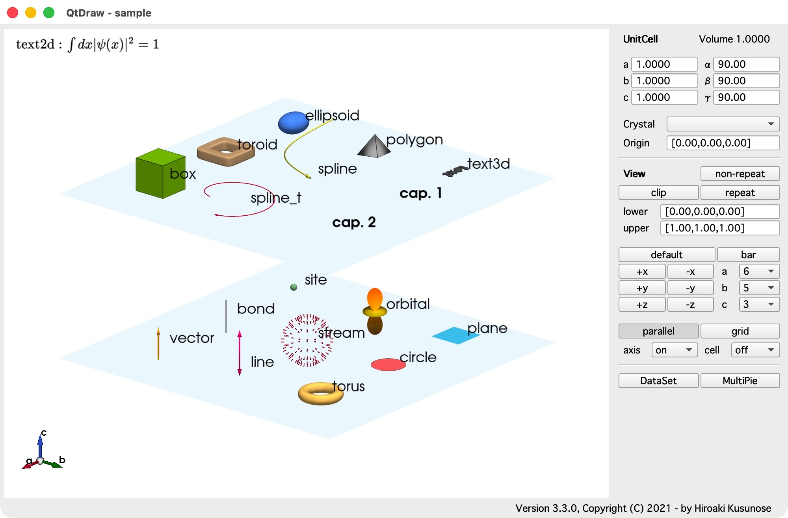
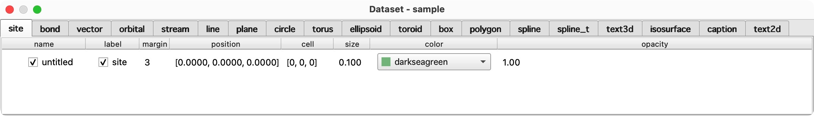
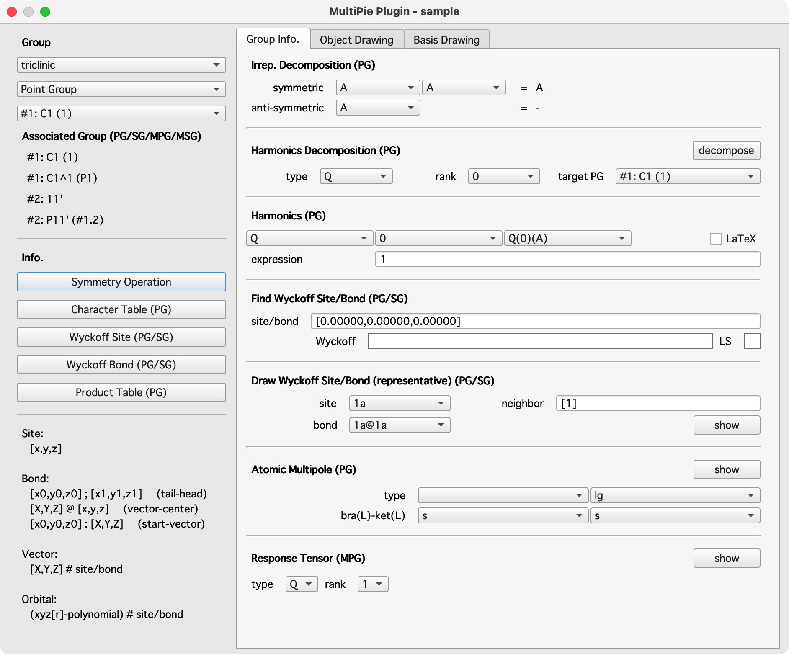
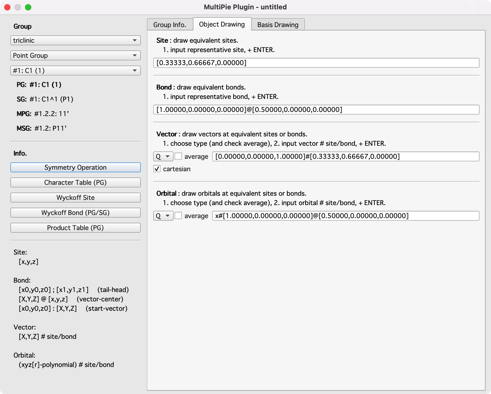
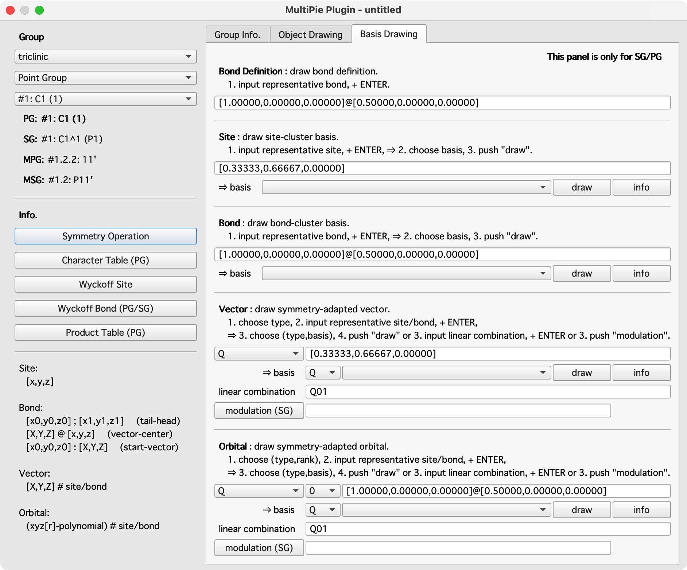

# 概要

英語版は[こちら](overview.md)です。

**QtDraw** は、[PyVista](https://docs.pyvista.org/) と [PySide6](https://doc.qt.io/qtforpython-6/index.html) をもとにした、特に分子や結晶のための 3D 描画ツールです。
メインウィンドウと使えるオブジェクトは次のようになります。

すべてのオブジェクトは、`DataSet` ウィンドウの GUI で変更できます。

すべてのオブジェクトは、`origin` を原点とする `crystal` 系の分率座標で、`position` + `cell` の位置に置かれます。これにより、`repeat` ボタンを押すだけで、描いたオブジェクトを繰り返すことができます。
`non-repeat` ボタンを押すと、繰り返したオブジェクトを、ホームセル（すなわち `cell=[0,0,0]`）の同じ `position` にあるオブジェクトに変換できます。

さまざまな結晶の対称操作と対称性適合多極子基底 (SAMB) の構成を提供する Python パッケージ [MultiPie](https://github.com/CMT-MU/MultiPie) をインストールすると、**QtDraw** でのオブジェクトの描画を対称操作や SAMB と関連づけることができます。
この機能を使うには、`MultiPie` をインストールしたあと、右下の `MultiPie` ボタンを押します。
`MultiPie` プラグインのウィンドウが別に表示され、次の三つのパネルからなります：

- **Group Info.**

    さまざまな群の情報を表示します。
    

- **Object Drawing**

    与えた対称操作によってオブジェクトを描きます。
    

- **Basis Drawing**

    SAMB のオブジェクトを（複数のセルにわたる変調も含めて）描きます。
    

API については、次を参照してください：

- [Core module](api_core.md)：エンドユーザー向けのコアモジュール。
- [Summary](api_summary.md)：実装のためのさまざまなモジュール。
